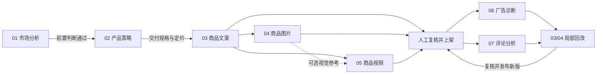

# Agent 串联工作流

按同一商品、平台和市场运行 01–05，人工复核后上架。发布后，有广告或评论数据时再运行 06/07，将可验证的修改建议回流到 03/04。

## 上架前

按各模块 README 填写输入模板，将系统 Prompt 和已填模板提供给模型，再按顺序执行任务 Prompt。一个平台与市场对应一份[上架素材包](./Templates/listing_asset_pack.md)。

| 阶段 | 输入和执行顺序 | 交付与中断条件 |
|---|---|---|
| [01 市场分析](./Agents/01_Market_Research_Agent/README.md) | 填写类目、公司资源和成本。按模块说明标准化导出数据、计算指标，再跑前置判断。前置判断通过后，用脚本指标完成市场分析。 | 向 02 交付 `target_price_range`、`recommended_config`、`opportunity_config` 和可取得的 `cost_floor_price`。结论为「不进入」时结束当前链路。条件待确认时，补证后重跑前置判断。 |
| [02 产品策略](./Agents/02_Product_Strategy_Agent/README.md) | 合并 01 的交付字段与可生产配置、成本及售后能力。运营人员确认选品并填写 `decision_approved: true`，再跑定位与定价。 | 交给 03 已确认的配置、`core_selling_point`、`secondary_points`、`forbidden_words_seed` 和 `after_sales_commitment`。保留 `breakeven_roas_by_sku` 供 06 使用。审批未通过时停在 02。 |
| [03 商品文案](./Agents/03_Listing_Creative_Agent/README.md) | 在已确认规格、包装、适用场景和关键词的基础上，依次生成标题与详情页，再做合规扫描。 | 保存文案和[共享 Product Brief](./Templates/product_brief_template.md)。参数出处或合规问题未解决时，回到 03 校正后再交接。 |
| [04 商品图片](./Agents/04_Product_Image_Agent/README.md) | 用 03 的 Product Brief 与实拍参考编制 9 图规划，再生成出图 Prompt 或版式要求。 | 输出图位规划、制作要求和成品图。将 `visual_tone_confirmed`、`hero_visual` 与 `key_visual_moments` 提供给 05 作可选参考。实拍图和平台要求待确认时，先补齐再提交对应图位。 |
| [05 商品视频](./Agents/05_Product_Video_Agent/README.md) | 用同一份 Product Brief 和 `title_final` 生成脚本、分镜、配音与字幕，按制作模式生成或实拍。 | 输出脚本与制作材料，并将上架范围内审核通过的成片纳入素材包。缺 `title_final` 时向 03 补取。 |

04 和 05 都要在开工前核对 `core_selling_point`、`secondary_points`、`spec_table`、`forbidden_words` 和 `usage_scope_confirmed`。这些上游字段任一缺失或为空时，记录 `[UPSTREAM_MISSING]` 和具体字段，由 03 补齐后继续。使用同一份已核验的 `spec_table` 比对文案、图片和视频中的数值。

任一阶段阻塞时，记录阶段、原因及待补输入。从该阶段恢复，并复核引用了变更字段的下游输出。例如，补齐 `title_final` 后可继续 05。若改动了 `spec_table`，则需同步复核 03、04 和 05。

### 发布检查

逐项完成[交付自检清单](./docs/04_Result_Checklist.md)中适用的条目，重点检查 A–E、I–K。到目标平台卖家中心复核当前字段、素材和类目要求。素材包仍缺必需成品或有未通过的检查项时，退回产出该内容的阶段。通过后，由运营人员发布素材包 `publish/` 中的内容，记录上架版本，作为后续诊断的基线。

## 上架后

| 分支 | 启动条件与数据限制 | 回流 |
|---|---|---|
| [06 广告诊断](./Agents/06_Advertising_Optimization_Agent/README.md) | 导入对应上架版本的广告数据和成本结构，用 02 的 `breakeven_roas_by_sku` 对照实际 ROAS。总曝光低于 1,000 时等待数据。周期少于 3 天时标注不稳定，无法核算盈亏线时仅做漏斗诊断。 | 按 `symptom_by_group` 选定待验证的病因。例如，CTR 问题可回到 03 改标题或回到 04 换主图。`review_needed` 为 true 时，用已有评论启动 07。 |
| [07 评论分析](./Agents/07_Review_Analysis_Agent/README.md) | 导入已脱敏的原语言评论及对应 `spec_table`、`package_content`。少于 20 条时，频次排序仅供参考，暂缓百分比结论。 | `review_patch_suggestions` 和经核验的 `forbidden_words_candidates` 交给 03。若 `packaging_clarity_needed` 为 true，由 04 补包装图。 |

1. 保留旧素材、诊断时间窗口和基线指标。把症状、改动对象和原素材传给对应模块，用 `mode = iterate` 修订。每轮只验证一个病因，指向同一病因的动作可以同批执行。
2. 如果回改影响了共享字段，先更新 Product Brief，再复核引用该字段的素材。按发布检查审核改动并保存为新版本。用[清单 H](./docs/04_Result_Checklist.md#h-闭环06--07--03--04)记录复测指标、周期和干扰项。
3. 广告侧通常在 7 天后复测，评论侧按 14–30 天复测。用复测指标和基线比较。达标时，结合库存和盈利情况决定是否放量。未达标时，回到相应诊断分支重新定位。

参照[电动滑板车素材案例](./Examples/01_Patinete_Eletrico_500W/README.md)查看 03–05 的交付样例，参照[闭环案例](./Examples/03_Closed_Loop/README.md)查看广告和评论的回流及复测。
